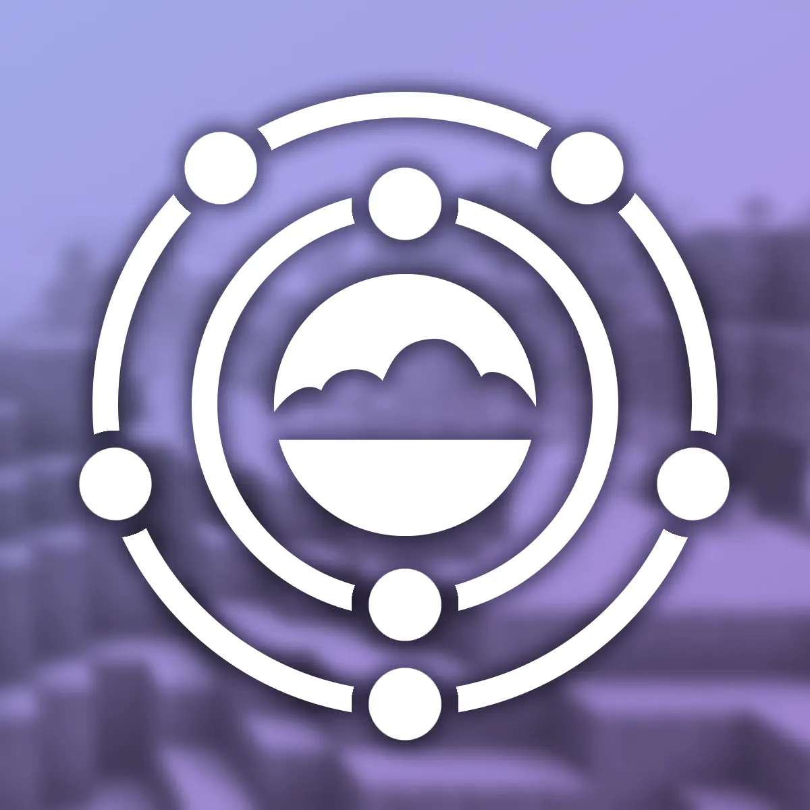

<p align="center"></p>

# Nitrogen (Fabric 1.21.11)

[](https://fabricmc.net/use/installer/)
[](https://www.minecraft.net/)
[](https://adoptium.net/)
[](LICENSE.txt)

This repository is a fork of [roggy666/Nitrogen-26.3-Fabric](https://github.com/roggy666/Nitrogen-26.3-Fabric), adapted for **Minecraft 1.21.11** on **Fabric**, running on **Java 21**. Nitrogen was originally created by The Aether Team.

---

## About Nitrogen

**Nitrogen** is an internal library mod originally developed by The Aether Team to share common functionality across their projects, including The Aether and The Aether II:
- Global loot modifiers (`LootModifierManager`, `AddEntityDropsModifier`)
- Biome modifiers (`BiomeModifierManager`, `AddMobChargeBiomeModifier`)
- User/patron tier data synchronization over the network
- Custom tree trunk and foliage placers
- Picture-in-Picture renderer support

---

## Changes in the Fabric 1.21.11 Port

* **Minecraft 1.21.11 and Fabric API:** Adapted to Minecraft 1.21.11 and Fabric API `0.141.3+1.21.11`.
* **Java 21 requirement:** Configured for Java 21 through Gradle toolchains (`JavaLanguageVersion.of(21)`).
* **Networking:** Packets use vanilla `CustomPacketPayload` with the Fabric Networking API (`ServerPlayNetworking`, `ClientPlayNetworking`), including send checks (`canSend`).
* **Loot and biome modifiers:** Handled by the `LootModifierManager` and `BiomeModifierManager` classes.
* **PIP rendering:** `BlockStateRenderer` and `FluidStateRenderer` are registered through `PictureInPictureRendererRegistry`.
* **Initialization:** `UserData` cache loading is deferred to `ServerLifecycleEvents.SERVER_STARTED` to avoid null pointer errors during world load.

---

## Building and Dependency Usage

### Requirements
* JDK 21

### Build and publish to Maven Local
```bash
./gradlew publishToMavenLocal
```

This publishes `com.aetherteam.nitrogen:nitrogen_internals-fabric:1.21.11-1.3.5-fabric` to your local Maven cache.

### Using Nitrogen as a dependency (`build.gradle`)
```groovy
repositories {
    mavenLocal()
}

dependencies {
    modImplementation "com.aetherteam.nitrogen:nitrogen_internals-fabric:${project.nitrogen_version}"
}
```

Set `nitrogen_version=1.21.11-1.3.5-fabric` in your `gradle.properties`.

---

## License

The code is distributed under the [LGPL v3.0](LICENSE.txt) license.
Original project: [The-Aether-Team/Nitrogen](https://github.com/The-Aether-Team/Nitrogen).
