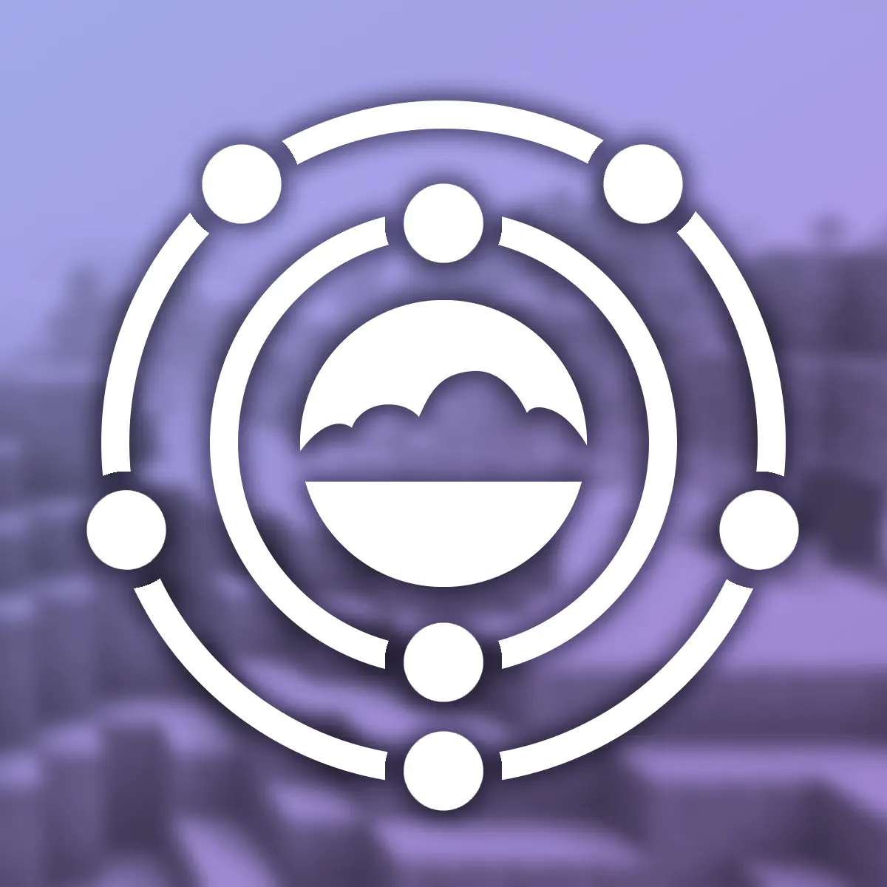

<p align="center"></p>

# Nitrogen (Fabric 1.21.11)

[](https://fabricmc.net/use/installer/)
[](https://www.minecraft.net/)
[](https://adoptium.net/)
[](../LICENSE.txt)

This repository is a fork of **Nitrogen** by The Aether Team, ported and updated for **Fabric Minecraft 1.21.11** (running on **Java 21**).

---

## 📖 About Nitrogen

**Nitrogen** is an internal library mod originally developed by The Aether Team to abstract and share common functionality across projects (including The Aether and The Aether II):
- Global loot modifiers (`LootModifierManager`, `AddEntityDropsModifier`)
- Biome modifiers (`BiomeModifierManager`, `AddMobChargeBiomeModifier`)
- User/patron tier data synchronization over the network
- Custom tree trunk and foliage placers
- Picture-in-Picture renderer support for Fabric 1.21.11

---

## 🛠️ Changes in the Fabric 1.21.11 Port

* **Minecraft 1.21.11 & Fabric API:** Fully adapted to Minecraft 1.21.11 and modern Fabric API (`fabric-api-0.141.3+1.21.11`).
* **Java 21 Requirement:** Configured strictly for Java 21 via Gradle toolchains (`JavaLanguageVersion.of(21)`).
* **Networking Stack:** Re-implemented all packets using vanilla `CustomPacketPayload` and Fabric Networking API (`ServerPlayNetworking`, `ClientPlayNetworking`), including safe transmission guards (`canSend`).
* **Loot & Biome Modifiers:** Replaced platform-dependent NeoForge modifier registries with native Fabric managers (`LootModifierManager`, `BiomeModifierManager`).
* **PIP Rendering:** Registered `BlockStateRenderer` and `FluidStateRenderer` using `PictureInPictureRendererRegistry`.
* **Safe Initialization:** Eliminated world loading NPEs by properly deferring `UserData` cache loading to `ServerLifecycleEvents.SERVER_STARTED`.

---

## 📦 Building & Dependency Usage

### Requirements:
* **JDK 21**

### Build and Publish to Maven Local:
```bash
./gradlew publishToMavenLocal
```

### Dependency Setup in Fabric Loom (`build.gradle`):
```groovy
repositories {
    mavenLocal()
}

dependencies {
    modImplementation "com.aetherteam.nitrogen:nitrogen:${project.nitrogen_version}"
}
```

---

## 📄 License

The code is distributed under the [LGPL v3.0](../LICENSE.txt) license.  
Original project: [The-Aether-Team/Nitrogen](https://github.com/The-Aether-Team/Nitrogen).
